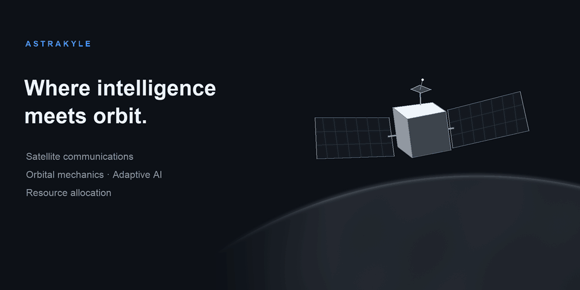

Astrakyle is a learning and research project exploring adaptive satellite communications constellations at the intersection of aerospace engineering and AI.

The planned simulation starts with circular low Earth orbits, a rotating spherical Earth, and ground locations with synthetic communication demand. Initial work will focus on satellite visibility and elevation angles, followed by satellite selection and allocation of limited communication capacity. Later stages will explore classical optimization and AI methods, including reinforcement learning, to adapt service to satellite failures, new satellites, and regional demand changes.

The project is in its initial setup stage. Its primary goal is to build a deep understanding of orbital mechanics, coverage, and resource allocation through incremental implementation. This README will evolve as development progresses.

## Research notes

The [project knowledge base](docs/README.md) records studied concepts, working assumptions, and open questions.

- [Satellite service conditions: visibility and elevation](docs/research/001-satellite-service-conditions.md) — includes illustrated geometry, service requirements, and the first simulation milestone.
- [Reference frames and Earth’s rotation](docs/research/002-reference-frames-and-earth-rotation.md) — ECI/ECEF transformations, local ENU coordinates, and antenna-pointing angles.
- [Circular orbital motion](docs/research/003-circular-orbital-motion.md) — orbital speed and period, plane orientation, and satellite ECI position over time.
