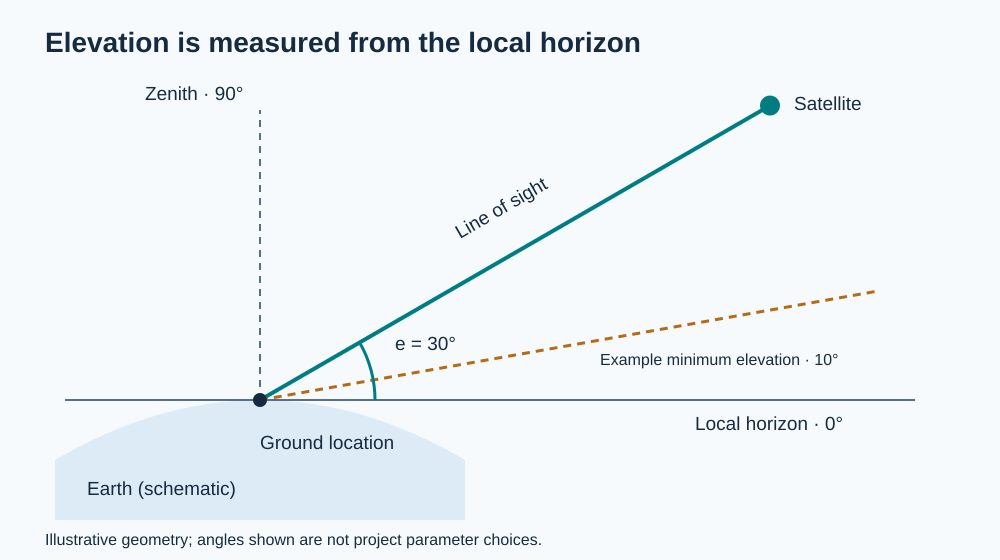
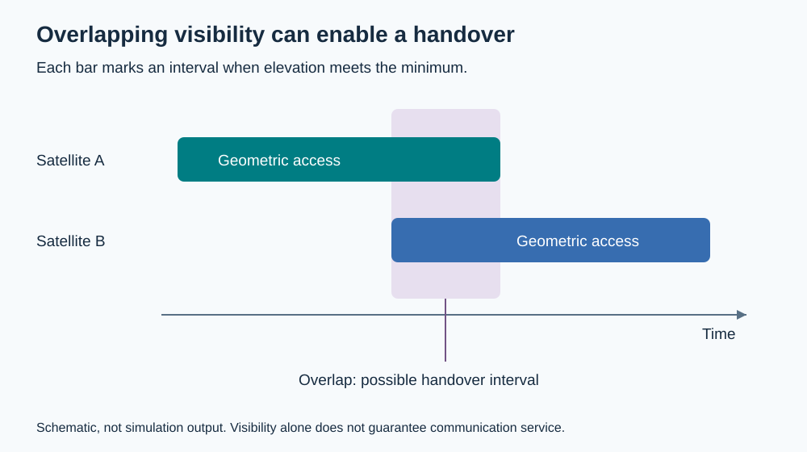

# 001 — Satellite service conditions

Date: 2026-10-18  
Status: Conceptual study; simulation not yet implemented  
Question: What enables a satellite to serve a particular ground location?

## Main conclusion

A satellite being above the horizon is a geometric prerequisite in our initial model. Successful communication also requires suitable antenna coverage, a usable radio link, available communication capacity, and a path through the network. Visibility alone does not guarantee service.

## Conditions for service

| Condition | What it means | Initial treatment |
| --- | --- | --- |
| Visibility | Earth does not block the ground-to-satellite line of sight, and elevation meets the chosen minimum. | First implementation milestone. |
| Antenna/beam coverage | The ground location lies within an active satellite beam, and the terminal can point or steer appropriately. | Initially assumed for geometrically eligible links. |
| Usable radio link | Received signal quality supports the intended communication, accounting for power, antenna gains, losses, noise, and interference. | Detailed link budget deferred. |
| Available capacity | The satellite has resources to serve the location's demand. | Introduce a simplified capacity limit after visibility. |
| Network connectivity | A suitable route connects the satellite link to the destination, such as through a gateway and, where applicable, inter-satellite links. | Initially assumed; explicit routing deferred. |

Beam coverage and allocation are distinct: a location inside a beam can still receive insufficient capacity. ESA describes both multi-beam coverage and adapting resources to changing demand [3].

## Visibility and elevation

The **local horizon** is the plane tangent to Earth at the ground location in our spherical-Earth model. **Elevation** is the angle from that plane toward the satellite. It is an angle, not the satellite's altitude above Earth's surface.

- **90°:** directly overhead, at the zenith.
- **0°:** on the ideal geometric horizon.
- **Below 0°:** blocked by Earth for a ground point on the spherical surface.
- **At or above the minimum elevation:** passes the initial geometric eligibility rule.

*Figure 1. A local cross-section. The 30° satellite elevation and 10° mask are illustrative, not selected project parameters. The Earth curvature is schematic.*

A positive minimum elevation excludes low-angle links. Real systems may also use a direction-dependent mask for terrain or structures; minimum-elevation and azimuth-dependent masks are supported in established access-analysis tools [1]. The project has not yet selected a minimum elevation.

### Calculation for the initial spherical model

Let **g** and **s** be the Earth-centered position vectors of the ground location and satellite, expressed in the **same coordinate frame at the same time**. Use consistent distance units.

The unit local-up vector and the ground-to-satellite vector are

$$
\hat{\mathbf{u}} = \frac{\mathbf{g}}{\|\mathbf{g}\|}, \qquad
\boldsymbol{\rho} = \mathbf{s}-\mathbf{g}.
$$

Projecting the line of sight onto local up gives

$$
e = \arcsin\left(\frac{\boldsymbol{\rho}\cdot\hat{\mathbf{u}}}{\|\boldsymbol{\rho}\|}\right).
$$

For numerical implementation, clamp the argument to [-1, 1] before applying arcsine, reject a zero-length line-of-sight vector, and convert radians to degrees if the threshold is in degrees.

For a surface ground point and a nonnegative minimum elevation, our eligibility rule is

$$
V(g,s,t) = \begin{cases}
1, & e(g,s,t) \ge e_{\min}, \\
0, & e(g,s,t) < e_{\min}.
\end{cases}
$$

The equality convention includes the boundary; exactly 0° is only an ideal tangent ray. This rule does not model terrain, atmospheric refraction, or radio propagation. On an ellipsoidal Earth, the local surface normal generally differs from the geocentric radial direction used above.

### A small geometry example

Take a ground location **g** = (R, 0, 0), so local up points along the positive x-axis. If **s** = (R + a, b, 0), with a > 0 and b ≥ 0, then

$$
e = \arctan2(a,b).
$$

For a = 500 km and b = 500 km, elevation is 45°. For b = 0, the satellite is overhead at 90°. Here a is the local-up displacement; it is not generally orbital altitude. These are geometric sanity checks, not simulated orbital positions.

## Motion, tracking, and handovers

A geostationary satellite ideally remains at the same apparent position relative to a fixed ground observer. A low Earth orbit satellite moves across the observer's sky, so directional terminals must track it and continued service may require switching to another satellite. ESA's introductory overview explains this distinction [2].

Earth rotation and orbital motion both affect the geometry over time. In an Earth-fixed frame, a fixed ground station has constant coordinates while the satellite coordinates change. In an inertial frame, the ground location rotates with Earth. Mixing these frames would produce incorrect elevation angles. [Note 002 — Reference frames and Earth’s rotation](002-reference-frames-and-earth-rotation.md) develops the transformations and local pointing calculations.

*Figure 2. Schematic access windows after applying an elevation mask. The overlap offers a possible handover interval; capacity, link quality, and network connectivity must still be checked. Bar widths are illustrative and are not simulated pass durations.*

Changing which satellite serves a location, steering a beam, and allocating capacity are communication-resource decisions. They do not necessarily involve changing satellite orbits. Initial adaptation experiments will focus on service allocation within the constellation geometry.

## First implementation milestone

Calculate elevation and geometric visibility between one satellite and one ground location over time. Begin with a spherical rotating Earth and a circular orbit, and state the frame, units, time step, and elevation mask explicitly.

Before interpreting coverage, verify overhead (90°), tangent (0°), below-horizon, and threshold-boundary cases. Check that an Earth-fixed calculation and an equivalent inertial-frame calculation agree. Time sampling can miss short access windows, so boundary timing will need attention when pass durations are measured.

No simulation results or measured service performance are available yet.

## Open questions

- What orbit altitude, inclination, and initial ground location should the first example use?
- What minimum elevation and time step should the simulation use?
- How should simplified satellite capacity and ground demand be represented?
- When should beam footprints, link budgets, and gateway connectivity become explicit?

## References and provenance

This note consolidates the project chats **Research** and **Satellite Service Conditions**. The vector calculation and illustrations are explanatory additions based on the stated spherical geometry. External references support the engineering terminology; they are not project dependency choices.

1. MathWorks, [groundStation: minimum elevation and visibility masks](https://www.mathworks.com/help/satcom/ref/matlabshared.satellitescenario.satellitescenario.groundstation.html). Accessed 2026-10-18.
2. ESA, [About Telecommunications](https://www.esa.int/Applications/Connectivity_and_Secure_Communications/About_Telecommunications). Accessed 2026-10-18.
3. ESA, [Automatically balanced load and increased capacity in communication systems and data networks](https://www.esa.int/Enabling_Support/Space_Engineering_Technology/Automatically_balanced_load_and_increased_capacity_in_communication_systems_and_data_networks). Accessed 2026-10-18.

Both figures are original, editable SVG diagrams created for this repository.
