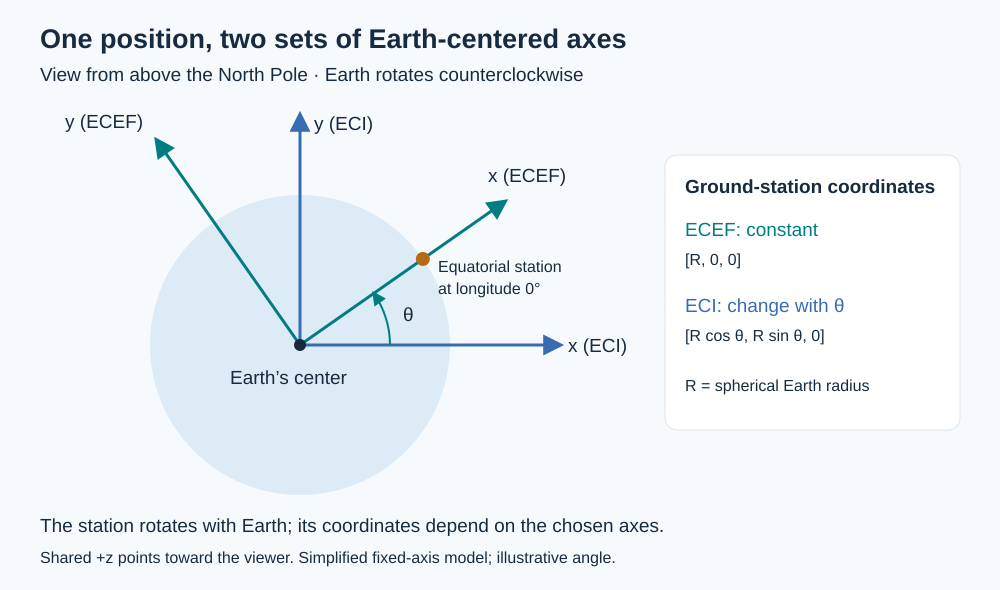

# 002 — Reference frames and Earth’s rotation

Date: 2026-10-18  
Status: Conceptual study; simulation not yet implemented  
Question: How do we express a ground location and an orbiting satellite in the same frame, then find where the satellite appears in the sky?

## Main conclusion

Before subtracting two positions, express them relative to the **same origin and axes at the same instant**, using consistent units. Earth rotation connects our simplified inertial and Earth-fixed frames. A local East–North–Up frame then converts the station-to-satellite vector into antenna-pointing angles and distance.

This extends [Note 001 — Satellite service conditions](001-satellite-service-conditions.md), which introduced elevation and geometric visibility.

## The three frames

| Frame | Origin | Axes | Role in Astrakyle |
| --- | --- | --- | --- |
| Earth-centered inertial (ECI) | Earth’s center | Approximately fixed relative to distant stars | Describe satellite orbital motion. |
| Earth-centered, Earth-fixed (ECEF) | Earth’s center | Rotate with Earth | Describe ground locations and compare positions relative to Earth. |
| East–North–Up (ENU) | Ground station | Local east, north, and up | Describe the satellite’s direction and slant range from the station. |

A stationary ground location has constant ECEF coordinates in our model. In ECI, an equatorial station traces a circle as Earth rotates. These are two descriptions of the same physical motion.

ECI denotes a family of frames, not a unique coordinate system. Here we use a simplified ECI frame whose z-axis coincides with Earth’s fixed rotation axis. We neglect precession, nutation, polar motion, and variations in rotation rate. These equations are an educational model, not a complete transformation between precise celestial and terrestrial reference systems.

*Figure 1. Both frames share Earth’s center and the positive z-axis, which points toward the viewer. The illustrated angle is arbitrary. A coordinate transformation describes a position in different axes; it does not move the physical object.*

## 1. Ground location in ECEF

For a spherical Earth with radius $R_E$, latitude $\phi$, east-positive longitude $\lambda$, and height $h$ above the sphere:

$$
\mathbf{r}_g^E = (R_E+h)
\begin{bmatrix}
\cos\phi\cos\lambda \\
\cos\phi\sin\lambda \\
\sin\phi
\end{bmatrix}.
$$

The ECEF x-axis passes through the equator at Greenwich, the y-axis through the equator at 90° east, and the z-axis through the North Pole. Superscripts $E$ and $I$ identify ECEF and ECI components, respectively; they are not powers. Trigonometric functions use radians, and $R_E$ and $h$ must use the same distance unit.

For an ellipsoidal Earth, the position formula must change. Geodetic latitude is defined by the surface normal, which generally differs from the geocentric radial direction.

## 2. Account for Earth’s rotation

Define $\theta(t)$ as the angle from the inertial x-axis to the Earth-fixed x-axis, positive toward the inertial y-axis. In our constant-rate model:

$$
\theta(t)=\theta_0+\omega_E(t-t_0), \qquad
\omega_E\approx7.292115\times10^{-5}\ \mathrm{rad/s}.
$$

The nominal angular velocity is listed by the IAU Working Group on Numerical Standards [2]. Use elapsed seconds for $t-t_0$. The initial angle $\theta_0$ specifies how the axes align at epoch $t_0$: the rotation rate alone cannot determine their orientation at a particular time. Setting $\theta_0=0$ is a possible synthetic-simulation convention, not an assertion about Greenwich at an arbitrary real date.

Define the rotation matrix explicitly so its sign is unambiguous:

$$
R_z(\theta)=
\begin{bmatrix}
\cos\theta & -\sin\theta & 0 \\
\sin\theta & \cos\theta & 0 \\
0 & 0 & 1
\end{bmatrix}.
$$

Then the ground position in ECI and the satellite position in ECEF are

$$
\mathbf{r}_g^I(t)=R_z(\theta(t))\mathbf{r}_g^E,
\qquad
\mathbf{r}_s^E(t)=R_z(-\theta(t))\mathbf{r}_s^I(t).
$$

The inverse rotation is the transpose: $R_z(-\theta)=R_z(\theta)^T$. At $\theta=90^\circ$, a station at $[R_E,0,0]^T$ in ECEF has coordinates $[0,R_E,0]^T$ in ECI. Its ECEF coordinates remain unchanged.

These are position transformations. Transforming velocities between rotating and inertial frames additionally requires accounting for the time derivative of the rotation; simply applying the position matrix is insufficient.

## 3. Form the station-to-satellite vector

Once both positions are in ECEF at the same time:

$$
\boldsymbol{\rho}^E(t)=\mathbf{r}_s^E(t)-\mathbf{r}_g^E
=\begin{bmatrix}\Delta x\\\Delta y\\\Delta z\end{bmatrix}.
$$

Alternatively, subtract in ECI:

$$
\boldsymbol{\rho}^I(t)=\mathbf{r}_s^I(t)-\mathbf{r}_g^I(t).
$$

Both approaches give the same slant range because rotations preserve length:

$$
d=\|\boldsymbol{\rho}^E\|=\|\boldsymbol{\rho}^I\|.
$$

Do not subtract an ECI satellite position directly from an ECEF ground position. Their common Earth-centered origin does not make their axes interchangeable.

## 4. Express the relative vector in ENU

At station latitude $\phi$ and longitude $\lambda$, project the relative ECEF vector onto the local axes:

$$
\begin{bmatrix}E\\N\\U\end{bmatrix}
=
\begin{bmatrix}
-\sin\lambda & \cos\lambda & 0 \\
-\sin\phi\cos\lambda & -\sin\phi\sin\lambda & \cos\phi \\
\cos\phi\cos\lambda & \cos\phi\sin\lambda & \sin\phi
\end{bmatrix}
\begin{bmatrix}\Delta x\\\Delta y\\\Delta z\end{bmatrix}.
$$

Each row is a local unit direction expressed in ECEF. The components $E,N,U$ are distances, not angles. Subtract the station position **before** applying this matrix: ENU is centered at the station. ESA Navipedia gives these local basis vectors and their relation to satellite directions [1].

For our sphere, up is radial. For an ellipsoid, use geodetic latitude and the corresponding ellipsoidal station position so that up follows the surface normal. At the geographic poles, a longitude convention is needed to choose local east and north.

## 5. Compute azimuth, elevation, and range

$$
A=\mathrm{atan2}(E,N)\pmod{2\pi},
\qquad
\epsilon=\mathrm{atan2}\left(U,\sqrt{E^2+N^2}\right),
\qquad
d=\sqrt{E^2+N^2+U^2}.
$$

Azimuth is measured clockwise from north: north = 0°, east = 90°, south = 180°, west = 270°. The argument order is **east first, north second**. Normalize to [0°, 360°) after converting from radians.

Elevation is measured above the local horizontal: 0° is the horizon, 90° is overhead, and negative values are below the local horizontal. We use $\epsilon$ for elevation to avoid confusing it with the east component; it is the same elevation called $e$ in Note 001.

For nonzero range, this elevation is equivalent to $\arcsin(U/d)$ and to Note 001’s projection onto local up. If both horizontal components vanish, azimuth is undefined. If the entire relative vector is zero, both pointing angles are undefined; an implementation should report that degeneracy explicitly.

### Worked example from the discussion

Suppose the local relative vector is $[E,N,U]=[300,400,500]$ km. Its horizontal length is 500 km.

| Quantity | Calculation | Result |
| --- | --- | --- |
| Azimuth | `atan2(300, 400)` | 36.87°, northeast |
| Elevation | `atan2(500, 500)` | 45° |
| Slant range | $\sqrt{300^2+400^2+500^2}$ | 707.1 km |

These are illustrative local coordinates, not a simulated orbital pass.

## Workflow and checks for implementation

**Satellite ECI → satellite ECEF → subtract station ECEF → relative ENU → azimuth, elevation, and range.** Apply the chosen minimum-elevation rule from Note 001 only after obtaining the elevation.

Useful checks when implementing this workflow:

- A +90° Earth rotation maps ECEF +x to ECI +y under the stated convention.
- A rotation followed by its inverse recovers the starting vector.
- Slant range agrees in ECI, ECEF, and ENU.
- At latitude 0°, longitude 0°, ECEF +y is east, +z is north, and +x is up.
- North and east horizon vectors yield azimuths 0° and 90° with elevation 0°.
- An overhead vector yields elevation 90° and undefined azimuth.
- The worked example reproduces 36.87°, 45°, and 707.1 km.

No orbit propagation or visibility simulation is implemented by this note.

## Open questions

- Which epoch and initial Earth angle should the first synthetic scenario use?
- How will the first circular orbit provide satellite ECI positions over time?
- Which units, time step, and minimum elevation will the simulation use?
- When will real ephemerides require a named precise frame and Earth-orientation model?

## References and provenance

This note consolidates the project chat **Reference frames and Earth’s rotation**, including its ECEF/ECI explanation, rotation convention, ENU transformation, and numerical example. The diagram and implementation checks organize that discussion for future use; they are not experimental results.

1. ESA Navipedia, [Transformations between ECEF and ENU coordinates](https://gssc.esa.int/navipedia/index.php/Transformations_between_ECEF_and_ENU_coordinates). Accessed 2026-10-18.
2. IAU Working Group on Numerical Standards for Fundamental Astronomy, [Current Best Estimates](https://iau-a3.gitlab.io/NSFA/NSFA_cbe.html), nominal mean angular velocity of Earth. Accessed 2026-10-18.

The figure is an original, editable SVG created for this repository.
